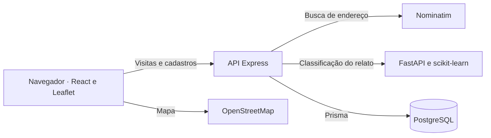

# VedaçãoHub — Apresentação

O VedaçãoHub é uma aplicação web para acompanhar obras de vedação industrial, desenvolvida como Trabalho de Conclusão de Curso de Engenharia de Software da Católica de Santa Catarina em parceria com uma empresa familiar do setor.

Na empresa, as equipes registravam as visitas em cadernos. Ao retomar uma obra, era preciso recuperar anotações anteriores para saber quais paredes ou placas já haviam recebido serviço, que material restava e por que o trabalho havia parado. O VedaçãoHub reúne a localização e o histórico de cada galpão para que a próxima equipe possa consultar essas informações antes de continuar.

## Acesso ao sistema

**[Abrir o VedaçãoHub na AWS](https://3-19-67-254.sslip.io/)** · O acesso às obras e visitas exige uma conta autorizada.

## Principais funcionalidades

- **Acesso da equipe.** O proprietário gerencia as contas dos funcionários. A API verifica a identidade e as permissões em cada operação protegida.
- **Galpões e mapa.** A equipe cadastra e edita galpões, pesquisa endereços e ajusta a localização por clique no mapa ou arraste do marcador. As coordenadas salvas são recuperadas ao reabrir o cadastro.
- **Visitas físicas.** O funcionário registra os serviços pelo nome e os materiais utilizados, restantes ou necessários pelo nome e quantidade. O relato guarda locais, quantidades de serviço, impedimentos e o motivo de uma visita sem execução. O formulário dispensa percentuais de conclusão.
- **Classificação e revisão.** Um classificador próprio analisa o relato. O proprietário pode consultar os avisos, ler o contexto e justificar a aprovação ou rejeição de uma visita pendente.
- **Histórico e auditoria.** As visitas e fotos ficam associadas ao galpão. O histórico mantém os dados antigos, inclusive percentuais já registrados, e a auditoria identifica os responsáveis pelas decisões.
- **Exclusão lógica.** O proprietário pode excluir uma visita pendente ou rejeitada mediante justificativa. A visita sai das consultas e exportações operacionais, e o banco preserva o registro e suas evidências.

## Como o VedaçãoHub funciona

1. **No galpão**, o funcionário entra no sistema, seleciona a obra e descreve a visita. Por exemplo, pode registrar a aplicação de P.U. em parte das placas e informar no relato quantas ficaram para a próxima visita.
2. **Ao enviar**, a API verifica as permissões e os dados do formulário. Para avaliar a coerência, consulta o serviço de IA e considera a situação declarada, os serviços cadastrados e as regras de validação.
3. **No histórico**, a API grava a visita no PostgreSQL com seu estado de revisão. Uma visita coerente pode ser aprovada automaticamente. Se houver uma possível contradição, o proprietário analisa a pendência e registra a decisão com justificativa.

## Tecnologias utilizadas

A interface usa **React e Vite**, com **React Leaflet, Leaflet, OpenStreetMap e Nominatim** para o mapa e a busca de endereços. A API usa **Node.js e Express**, com **Prisma ORM e PostgreSQL** para persistência. O serviço de IA usa **Python, FastAPI e scikit-learn**.

O ambiente é organizado com **Docker Compose**. Em produção, a aplicação é hospedada em **AWS EC2** com HTTPS pelo **Caddy**. O **GitHub Actions** executa a integração contínua e publica imagens no **GitHub Container Registry (GHCR)**.

## Arquitetura

| Componente | Responsabilidade |
|---|---|
| React e Vite | Interface de cadastro, visitas e revisão humana |
| React Leaflet e OpenStreetMap | Marcação e recuperação da localização. A API consulta Nominatim por busca explícita, com cache e limitação de frequência |
| Express e Prisma | Autenticação JWT, autorização por perfil, regras de validação, auditoria e persistência |
| PostgreSQL | Galpões, visitas, materiais registrados, usuários, rótulos e fotos |
| FastAPI e scikit-learn | Inferência local sobre os relatos. As classes são execução, ausência de execução e situação indefinida |

A pasta [web/](web/) contém as telas e o mapa usados pela equipe. Em [api/](api/) ficam as rotas, regras de negócio e o esquema do banco. A pasta [ia/](ia/) reúne o treinamento e a API interna do classificador.



## Testes e resultados

A tabela apresenta a **cobertura unitária de linhas** documentada para a revisão avaliada no artigo. Os resultados são históricos. A execução da CI de cada revisão gera seus próprios relatórios. [Auditoria e método de medição](docs/wiki/conformidade.md)

| Suíte unitária | Testes aprovados | Linhas exercitadas | Cobertura | Meta mínima |
|---|---:|---:|---:|---:|
| Backend Express | 43 | 568 de 706 | **80,45%** | 75% |
| Frontend React | 6 | 79 de 292 | **27,05%** | 25% |

Os testes integrados percorrem a API via HTTP, com PostgreSQL temporário e o serviço de IA em Docker. Exercitam permissões, registro de visita, revisão e auditoria. Os testes de interação do frontend usam um DOM de teste e respostas HTTP controladas. A suíte Python é executada separadamente. [Fluxo integrado](api/tests/integration/fluxo.test.js) · [Testes de interação](web/tests/fluxo.spec.jsx)

Com Node.js 22.12+ e Docker Compose v2, execute na raiz do clone:

```sh
node scripts/ci.mjs
```

O comando constrói as imagens, gera credenciais temporárias e executa pytest, ESLint, testes Node e React, integração e build Vite em um projeto Compose isolado, com PostgreSQL em memória. A cobertura considera os arquivos JS de produção em `api/src/`, os scripts JS do Prisma e os arquivos JS e JSX de `web/src/`, inclusive arquivos sem execução.

Os relatórios unitários ficam em `api/coverage/unit/` e `web/coverage/unit/`. Para as suítes mais amplas, abra `api/coverage/index.html` e `web/coverage/react/index.html`. Os diretórios incluem LCOV e resumo JSON. Em pushes e pull requests, o GitHub Actions usa o mesmo comando e disponibiliza os relatórios no artefato **cobertura**.

## Inteligência artificial

A IA auxilia a leitura de relatos de obra. Por exemplo, “restam seis placas” pode indicar execução parcial quando o restante do texto descreve as placas já concluídas. O classificador treinado no projeto atribui uma das três situações ao texto:

| Classe | Interpretação |
|---|---|
| `TRABALHO_EXECUTADO` | O relato descreve uma atividade realizada, inclusive parcialmente. |
| `SEM_EXECUCAO` | O relato informa que nenhum serviço foi executado na visita. |
| `INDEFINIDO` | O texto não permite determinar com clareza se houve execução. |

O treinamento usa relatos **sintéticos** e scikit-learn. A API combina a previsão com regras objetivas e serviços informados. Uma negação explícita pode exigir revisão humana mesmo quando há um serviço cadastrado. [Treinamento, avaliação e comparação com a referência por palavras-chave](docs/validacao_execucao_parcial.md)

## Como executar localmente

Para uma **instalação nova**, use Docker com Compose v2 e execute os comandos na raiz do repositório.

1. Copie `.env.example` para `.env`. Para `POSTGRES_PASSWORD` e `JWT_SECRET`, gere dois valores independentes de 32 bytes aleatórios cada, codificados em hexadecimal. Defina `CORS_ORIGIN=http://localhost:5173`.
2. Construa as imagens e aguarde o PostgreSQL:

   ```sh
   docker compose build
   docker compose up -d --wait postgres
   ```

3. Aplique as migrações ao banco **novo e vazio**. Em uma instalação existente, confira o histórico do Prisma e faça backup antes de qualquer migração.

   ```sh
   docker compose run --rm --no-deps api npx prisma migrate deploy
   ```

4. Para criar a primeira conta de proprietário, disponibilize `ADMIN_EMAIL` e `ADMIN_PASSWORD` no ambiente do terminal. Use uma senha exclusiva e remova as duas variáveis do terminal após executar:

   ```sh
   docker compose run --rm --no-deps -e ADMIN_EMAIL -e ADMIN_PASSWORD api node prisma/bootstrap-admin.js
   ```

5. Inicie os serviços e abra a [interface local](http://localhost:5173). As portas locais ficam restritas ao loopback. A carga de dados demonstrativos (seed) é opcional e exige execução explícita.

   ```sh
   docker compose up -d --wait
   ```

Para usar o Nominatim público, mantenha uma única instância da API para respeitar o limite global de uma busca por segundo. A busca é explícita, com identificação da aplicação, atribuição e cache. Use endereços públicos e evite enviar dados confidenciais. [Política do Nominatim](https://operations.osmfoundation.org/policies/nominatim/)

## Hospedagem e atualização

Na EC2 Ubuntu, o Docker Compose executa os serviços e o Caddy recebe as conexões HTTPS. Após os testes aprovados em um push na `main`, o GitHub Actions publica imagens no GHCR e uma release com seus digests. O mecanismo de atualização usa um timer do systemd na EC2 para consultar a release e atualizar os serviços alterados. A configuração, o rollback e a conferência da revisão aplicada estão no [procedimento de implantação](docs/wiki/deploy.md).

## Documentação acadêmica

- [Artigo do TCC em Engenharia de Software da Católica de Santa Catarina (PDF)](Artigo_N3.pdf)
- [Wiki técnica, requisitos e três fluxos de negócio](docs/wiki/README.md)
- [Contrato das visitas físicas e compatibilidade com o histórico](docs/visitas_fisicas.md)
- [Auditoria de conformidade com a linha Web Apps](docs/wiki/conformidade.md)

## Limitações

A avaliação documentada cobre o comportamento do software em cenários testados e a classificação de relatos sintéticos. Ainda falta uma avaliação operacional independente na empresa. A generalização da IA para relatos reais, o efeito sobre a produtividade da equipe e a usabilidade em campo permanecem sem medição independente.
