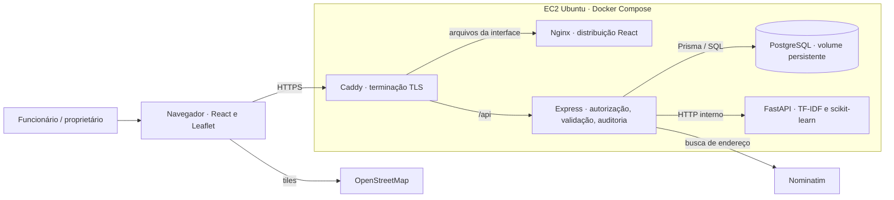

# Wiki técnica do VedaçãoHub

[Aplicação pública](https://3-19-67-254.sslip.io/) · [Operação e deploy](deploy.md) · [Matriz de conformidade](conformidade.md) · [Contrato das visitas](../visitas_fisicas.md)

## Requisitos funcionais e atores

| Ator e objetivo | Comportamento verificável |
|---|---|
| Como proprietário, quero dar acesso à equipe | Cadastro de funcionário, desativação e invalidação da sessão. A API verifica o perfil. |
| Como funcionário, quero localizar uma obra | Cadastro do galpão com endereço e coordenadas. A consulta carrega a localização salva. |
| Como funcionário, quero registrar uma visita | Registro de execução, ausência de execução ou situação indefinida, com relato e materiais. As fotos ficam associadas à visita. |
| Como proprietário, quero decidir sobre divergências | Pendências exigem revisão humana justificada. Exclusão lógica de pendentes e rejeitadas preserva evidências e autoria. |
| Como proprietário, quero prestar contas | Histórico, exportação e auditoria identificam a obra, o registro e o responsável. |

## Três fluxos de negócio

1. **Habilitar a equipe.** O proprietário autenticado cadastra o funcionário. O funcionário entra e consulta os galpões disponíveis. Se a conta for desativada, a API recusa a sessão anterior. Evidência no teste de integração de cadastro, permissões e revogação.
2. **Registrar o trabalho no galpão.** Com um galpão ativo, o funcionário registra a situação, o relato e, quando aplicável, serviços e materiais. A API valida e consulta a IA. Uma visita coerente é aprovada e fica disponível no histórico. Uma contradição gera pendência. Uma data inválida bloqueia o cadastro. Evidência no teste integrado de registro físico e validação híbrida.
3. **Resolver uma pendência.** O proprietário abre Revisões, lê relato e avisos, informa a justificativa e aprova ou rejeita. O sistema registra a decisão uma vez na auditoria. Em caso de duplicidade, o proprietário pode excluir logicamente a visita pendente ou rejeitada com motivo. Ela sai das consultas operacionais e suas evidências permanecem no banco. Evidência nos testes de revisão, exclusão e exportação.

[Suíte HTTP com PostgreSQL](../../api/tests/integration/fluxo.test.js) · [Testes de interação React](../../web/tests/fluxo.spec.jsx)

## Arquitetura C4

**Contexto.** Funcionários e proprietário usam o VedaçãoHub pelo navegador. O sistema guarda dados de obras, aplica regras e sugere revisão de relatos. O mapa usa tiles externos e geocodificação explícita. A IA pertence ao sistema.

**Contêineres e fronteiras.** O diagrama representa o ambiente informado pelo operador e as conexões implementadas. A sonda externa verifica apenas a cadeia pública web/API/banco.

No Express, módulos específicos tratam autenticação, schemas, validação física, consulta à IA, geografia e relatórios. O frontend separa mapa, formulário físico, navegação e cliente HTTP. Várias rotas continuam concentradas em `server.js` e várias telas em `main.jsx`. A divisão funcional está documentada, mas a aderência integral ao RFC depende de confrontar a versão aprovada pela instituição.
